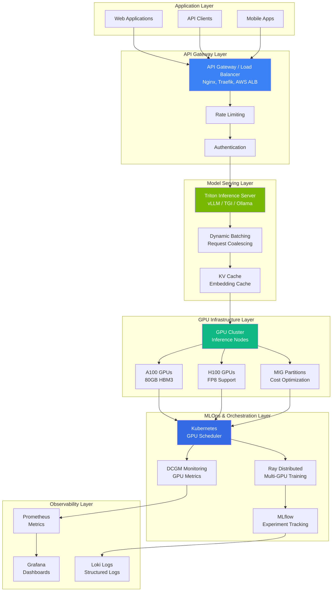
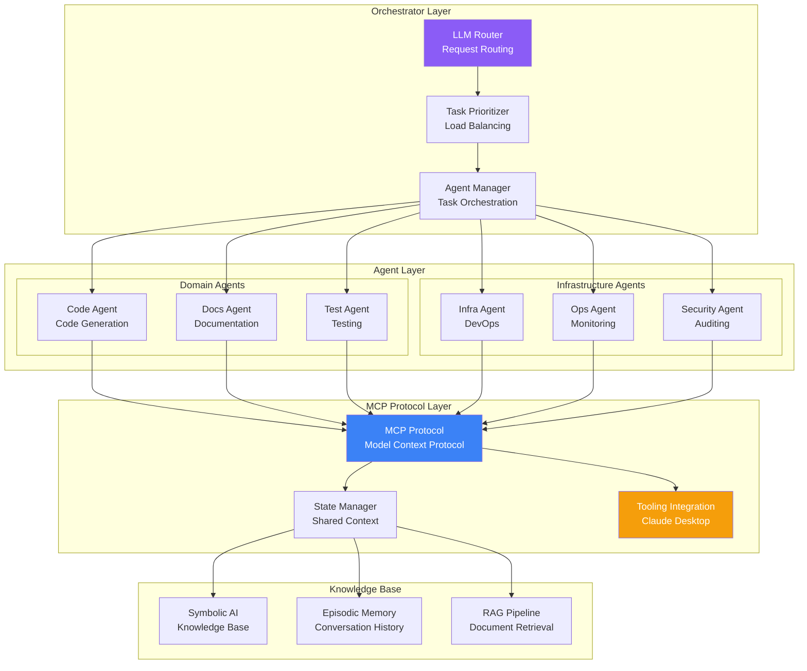

# LLM & AI Infrastructure Demos

Production-grade Large Language Model deployments, AI/ML infrastructure, and MLOps pipelines with deep NVIDIA expertise.

## 📋 Overview

This directory contains comprehensive demonstrations of AI/ML infrastructure, LLM deployment patterns, and MLOps best practices. Focus areas include **NVIDIA GPU optimization**, **multi-agent AI systems**, and **production LLM operations**.

### What You'll Find Here

| Category | Description | Where to look |
| --- | --- | --- |
| **Environment setup** | NVIDIA drivers, P2P, and cloud GPU options | [Nvidia_software.md](Nvidia_software.md), [Nvidia_cloud_vendors.md](Nvidia_cloud_vendors.md) |
| **Fine-tuning** | A Cog/Replicate walkthrough and config-driven experiments | [Make_Your_Own_LLM.md](Make_Your_Own_LLM.md), [finetuning/](finetuning/) |
| **Serving** | Single-GPU llama-server and a TensorZero gateway | [inference-platform/](inference-platform/), [tensorzero-gateway/](tensorzero-gateway/) |
| **Observability** | Trace, playground, and teardown notes | [tensorzero-evaluation.md](tensorzero-evaluation.md) |
| **RAG** | Chainlit + Qdrant + Cohere reranking | [chainlit_rust_rag/](chainlit_rust_rag/) |
| **Model internals** | Reversible embedding and output-head edits | [vocab_surgery/](vocab_surgery/) |
| **Experiments** | GRPO maze solving, research notes, DeepSeek notes | [alpha_maze_finder_grpo/](alpha_maze_finder_grpo/), [UsingDeepseek.md](UsingDeepseek.md) |
| **Security research** | Prompt injection and jailbreak notes | [attacks/](attacks/) |
| **Evaluations** | Gemma 3 multimodal benchmark notes | [Multimodal_benchmarks_Gemma3.md](Multimodal_benchmarks_Gemma3.md) |

Some older notes referenced guides that were never written (`LLM_Getting_Started.md`,
`Nvidia_cuda_optimization.md`, `Mlflow.md`, `Ray.md`, `Vertex.md`, `Inference.md`).
Those references were removed rather than replaced with links to nonexistent files.

---

## 🚀 Quick Start

### Understand the environment

1. **[NVIDIA software setup](Nvidia_software.md)** - driver, P2P, and cluster setup notes
2. **[Cloud GPU vendors](Nvidia_cloud_vendors.md)** - GPU cloud options
3. **[Make Your Own LLM](Make_Your_Own_LLM.md)** - a fine-tuning and deployment walkthrough

### Run a serving or RAG demo

- **[Inference platform](inference-platform/)** - llama-server on a single 16 GB GPU
- **[TensorZero gateway](tensorzero-gateway/)** - gateway and UI over a local model fleet
- **[Chainlit RAG](chainlit_rust_rag/)** - retrieval-augmented generation pipeline

### Read the operations notes

- **[MLOPS.md](MLOPS.md)** - operations notes and entry point
- **[TensorZero evaluation notes](tensorzero-evaluation.md)** - traces, playground, and config

---

## 🧭 Topic Guides

### NVIDIA GPU Setup

[Nvidia_software.md](Nvidia_software.md) covers driver and P2P setup;
[Nvidia_cloud_vendors.md](Nvidia_cloud_vendors.md) covers cloud GPU options. For a
small CUDA kernel comparison with explicit timing methodology, see
[rust_matrix_multiplication](../rust/rust_matrix_multiplication/).

### MLOps Pipeline Integration

[MLOPS.md](MLOPS.md) is the notes entry point. Runnable pieces are the
[inference platform](inference-platform/), the
[TensorZero gateway](tensorzero-gateway/), and the
[evaluation notes](tensorzero-evaluation.md).

### Distributed ML with Ray

There is no standalone Ray example in this repository yet. The closest runnable
experiments are [GRPO maze solving](alpha_maze_finder_grpo/) and the
[fine-tuning configs](finetuning/). Treat [MLOPS.md](MLOPS.md) as notes, not as a
verified Ray deployment.

### Retrieval-Augmented Generation (RAG)

[chainlit_rust_rag/](chainlit_rust_rag/) is the RAG implementation: mixed
PDF/HTML/Markdown ingestion, HuggingFace embeddings, Qdrant, and Cohere reranking.

---

## 🏗️ Architecture Patterns

### LLM Serving Stack

### Multi-Agent AI Systems

---

## 💡 NVIDIA Technologies

### CUDA Optimization

**Key Areas:**

- **Kernel tuning** - Optimize CUDA kernels for specific workloads
- **Memory management** - Efficient GPU memory allocation
- **Batching strategies** - Optimize inference throughput
- **Multi-GPU scaling** - Model parallelism and data parallelism

### MIG (Multi-Instance GPU)

Partition single GPU into multiple instances for:

- **Cost optimization** - Run multiple smaller models on one GPU
- **Isolation** - Separate workloads with dedicated GPU slices
- **Efficiency** - Better utilization for varied workload sizes

### Triton Inference Server

Production-grade model serving:

- **Multiple model formats** - TensorFlow, PyTorch, ONNX, TensorRT
- **Dynamic batching** - Group requests for better GPU utilization
- **Model ensemble** - Serve multiple models together
- **Version management** - A/B testing and rolling updates

### DCGM (Data Center GPU Manager)

Comprehensive GPU monitoring:

- **Real-time metrics** - Utilization, memory, temperature
- **Alerting** - Proactive issue detection
- **Profiling** - Performance optimization insights

---

## 📚 Key Concepts Explained

### Model Serving Strategies

| Strategy          | When to Use           | Pros                  | Cons                     |
| ----------------- | --------------------- | --------------------- | ------------------------ |
| **REST API**      | General applications  | Simple, universal     | Latency, stateless       |
| **gRPC**          | Microservices         | Faster, bidirectional | More complex setup       |
| **WebSocket**     | Streaming responses   | Real-time updates     | Connection overhead      |
| **Streaming API** | LLM generation tokens | Low latency per token | More complex client code |

### Inference Optimization

**1. Quantization**

- Reduce precision (FP32 → FP16 → INT8)
- Trade accuracy for speed
- Post-training quantization (PTQ) vs Quantization-aware training (QAT)

**2. Pruning**

- Remove less important weights
- Sparse models with structured pruning
- Retrain for accuracy recovery

**3. Knowledge Distillation**

- Train smaller model to mimic larger model
- Transfer knowledge efficiently
- Maintain accuracy with smaller footprint

**4. Caching & Memoization**

- Cache common embeddings
- Reuse intermediate computations
- KV cache for autoregressive generation

---

## 🔧 Technologies Demonstrated

### Model Serving

- **Triton Inference Server** - Production model serving
- **vLLM** - High-throughput LLM serving
- **Text Generation Inference (TGI)** - HuggingFace's optimized server

### Orchestration

- **Kubernetes** - Container orchestration with GPU support
- **Ray** - Distributed computing framework
- **Kubeflow** - Kubernetes-native ML platform

### Experiment Tracking

- **MLflow** - Experiment tracking and model registry
- **Weights & Biases** - MLOps platform
- **Vertex AI Experiments** - Google Cloud ML platform

### GPU Management

- **NVIDIA CUDA** - GPU programming framework
- **NVIDIA Triton** - Model serving and optimization
- **NVIDIA DCGM** - GPU monitoring
- **NVIDIA MIG** - GPU partitioning

---

## 🎯 Use Cases

### When to Use These Patterns

✅ **Ideal for:**

- Production LLM deployments at scale
- Multi-model serving scenarios
- GPU-accelerated ML pipelines
- Real-time inference workloads
- Cost-optimized GPU utilization
- Multi-agent AI systems

❌ **Not ideal for:**

- Simple API integrations without scaling needs
- Prototyping without GPU resources
- Batch-only workloads (use GPU instances directly)

---

## 📊 Performance Considerations

### GPU Optimization

**Throughput Optimization:**

- Batch size tuning
- Dynamic batching strategies
- Mixed precision training/inference (FP16/BF16)
- Tensor cores utilization

**Latency Optimization:**

- Model quantization (INT8)
- Cache embeddings and attention states
- Stream responses (token-by-token)
- GPU scheduling optimization

**Cost Optimization:**

- MIG GPU partitioning
- Spot/preemptible instances
- Model serving consolidation
- Right-sizing GPU resources

### Scaling Strategies

| Scale                       | Strategy             | GPU Configuration                   |
| --------------------------- | -------------------- | ----------------------------------- |
| **Small** (1-10 users)      | Single GPU with MIG  | 1x L40 (2-4 instances)              |
| **Medium** (10-100 users)   | Small GPU cluster    | 2-4x A100/H100                      |
| **Large** (100-1000+ users) | Multi-region cluster | 8-16x A100/H100 with load balancing |

---

## 🔍 Common Issues & Solutions

### GPU Memory Issues

| Issue                   | Symptoms            | Solution                                                  |
| ----------------------- | ------------------- | --------------------------------------------------------- |
| **CUDA OOM**            | Out of memory error | Reduce batch size, use MIG, enable gradient checkpointing |
| **Low GPU Utilization** | GPU not fully used  | Increase batch size, optimize data pipeline               |
| **Slow Inference**      | High latency        | Enable quantization, use TensorRT, optimize kernels       |

### Model Serving Issues

| Issue                      | Symptoms                | Solution                                                                  |
| -------------------------- | ----------------------- | ------------------------------------------------------------------------- |
| **High Latency**           | Slow response times     | Enable batching, optimize model serving, use faster hardware              |
| **Poor Throughput**        | Low requests per second | Increase batch size, add more GPUs, optimize inference code               |
| **Model Loading Failures** | Models fail to load     | Check CUDA compatibility, verify model format, allocate sufficient memory |

---

## 🎓 Learning Path

### Beginner

1. Read [Nvidia_software.md](Nvidia_software.md)
2. Read [Nvidia_cloud_vendors.md](Nvidia_cloud_vendors.md)
3. Follow [Make_Your_Own_LLM.md](Make_Your_Own_LLM.md)

### Intermediate

4. Work through [MLOPS.md](MLOPS.md)
5. Run the [inference platform](inference-platform/)
6. Explore the [TensorZero gateway](tensorzero-gateway/) and its
   [evaluation notes](tensorzero-evaluation.md)

### Advanced

7. Study [UsingDeepseek.md](UsingDeepseek.md) and [vocab_surgery/](vocab_surgery/)
8. Review [attacks/](attacks/) for adversarial testing notes
9. Compare matrix kernels in [rust_matrix_multiplication](../rust/rust_matrix_multiplication/)

---

## 🔗 External Resources

### Official Documentation

- [NVIDIA CUDA Documentation](https://docs.nvidia.com/cuda/) - CUDA programming guide
- [NVIDIA Triton](https://developer.nvidia.com/triton-inference-server) - Model serving
- [HuggingFace Transformers](https://huggingface.co/docs/transformers/) - Model libraries
- [vLLM](https://docs.vllm.ai/) - High-throughput LLM serving

### Research & Learning

- [Papers With Code](https://paperswithcode.com/) - ML research and implementations
- [The LLM Book](https://llmbook.github.io/) - Comprehensive LLM guide

---

## 🤝 Contributing

Have ideas for new patterns or improvements? Please open an issue or PR following our [contributing guidelines](../../CONTRIBUTING.md).

---

## 📄 License

All demos and documentation in this directory are licensed under MIT License. See [LICENSE](../../LICENSE) for details.

---

**Built with ❤️ for production AI/ML infrastructure with deep NVIDIA expertise.**
