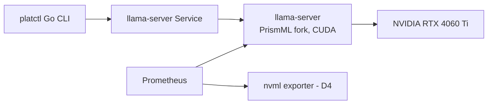

# Inference Platform

Production-shaped LLM inference demos on a single 16 GB GPU (RTX 4060 Ti).
Five demos, one shared harness. Arc spec:
`docs/superpowers/specs/2026-09-14-inference-platform-demos-design.md`.

## Architecture

## Status

| Demo | Dir | Status |
|------|-----|--------|
| D1 serving-base | `serving-base/` | in progress |
| D2 batching-loadtest | — | planned |
| D3 observability-spine | — | planned |
| D4 cost-dashboard | — | planned |
| D5 quant-bakeoff | — | planned |

## Pins

- llama.cpp fork: `PrismML-Eng/llama.cpp` @ `6ac5eb087009a762a3f61876f7dc152bc8600bf4`
- Model: `prism-ml/Ternary-Bonsai-1.7B-gguf` rev `983b5dec2ff16aab79990711ba0f828a499a7e6a`
- Upstream ternary (Q2_0) CUDA support is still migrating — track
  <https://docs.prismml.com/download/formats> before unpinning the fork.
