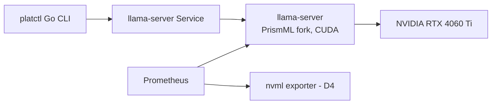

# D1 · serving-base Implementation Plan

> **For agentic workers:** REQUIRED SUB-SKILL: Use superpowers:subagent-driven-development (recommended) or superpowers:executing-plans to implement this plan task-by-task. Steps use checkbox (`- [ ]`) syntax for tracking.

**Goal:** Stand up Ternary-Bonsai-1.7B-Q2_0 under `llama-server` on single-node k3s with health checks, Prometheus scrape, and a reproducible committed latency report, creating the shared harness for demos D2–D5.

**Architecture:** One-time sudo bootstrap brings up k3s (with NVIDIA containerd runtime + local insecure registry for agent-built images). Rootless podman (subuid granted at bootstrap) builds the llama-server image from a pinned PrismML fork commit and pushes it to the in-cluster registry. A Go CLI (`platctl`) probes the OpenAI-compatible endpoint, measures TTFT/ITL from the SSE stream, and emits JSON + Markdown reports. All model/fork versions are pinned and hash-verified.

**Tech Stack:** k3s v1.32.3, llama.cpp (PrismML fork, CUDA), podman 5.8.4, Go 1.27 (module targets go 1.23), Cobra, yaml.v3, Prometheus v2.55.1, NVIDIA k8s-device-plugin v0.17.1, CUDA 12.8.1 base images.

**Spec:** `docs/superpowers/specs/2026-09-14-serving-base-d1-design.md` (governs; deviations noted in Task 3/5).

**Pinned versions (verified 2026-09-14):**
- Fork commit: `6ac5eb087009a762a3f61876f7dc152bc8600bf4` (`PrismML-Eng/llama.cpp`, branch `prism`)
- Model repo revision: `983b5dec2ff16aab79990711ba0f828a499a7e6a`
- Model file: `Ternary-Bonsai-1.7B-Q2_0.gguf`, 463290464 bytes, sha256 `d97d94eb564590c9f0300e54d3f87bbbb25a78693d0ade9f6e177973dcb8228a`

---

## File Structure

```
demos/llm/inference-platform/
├── README.md                        # arc overview, mermaid diagram, status table
├── shared/
│   ├── llama-server/
│   │   ├── Dockerfile               # two-stage CUDA build of pinned fork
│   │   ├── FORK_COMMIT              # single line: commit sha
│   │   └── build.sh                 # podman build + push to in-cluster registry
│   ├── deploy/
│   │   ├── kustomization.yaml
│   │   ├── namespace.yaml           # ns inference
│   │   ├── registry.yaml            # registry:2 in-cluster, hostPort 5000
│   │   ├── device-plugin.yaml       # nvidia k8s-device-plugin DaemonSet
│   │   ├── models-pv.yaml           # hostPath PV+PVC for model weights
│   │   ├── llama-server.yaml        # Deployment + Service
│   │   └── prometheus.yaml          # Prometheus + static scrape of llama-server
│   ├── platctl/
│   │   ├── go.mod
│   │   ├── cmd/platctl/main.go      # cobra root + probe subcommand
│   │   ├── internal/suite/suite.go  # suite YAML types + loader
│   │   ├── internal/probe/probe.go  # SSE probe client, TTFT/ITL measurement
│   │   ├── internal/report/report.go# JSON + Markdown report rendering
│   │   └── internal/.../*_test.go   # TDD tests per package
│   └── prompts/latency-suite.yaml   # fixed prompt suite, pinned settings
└── serving-base/
    ├── README.md                    # bring-up order, report regeneration
    ├── scripts/
    │   ├── 00-bootstrap-host.sh     # MANUAL SUDO GATE: k3s + nvidia + subuid
    │   ├── 10-build-image.sh        # delegates to shared/llama-server/build.sh
    │   ├── 20-apply-manifests.sh    # fetch model (sha256-verified) + apply
    │   └── 30-report.sh             # assemble meta, port-forward, probe
    └── reports/                     # generated artifacts (committed)
```

**Environment facts the executor must know (verified):**
- Host: Fedora 44 Toolbx container, systemd is PID 1, user `a` uid 1000, **sudo is NOT passwordless** (bootstrap script is a manual gate the user runs).
- GPU: RTX 4060 Ti 16380 MiB, driver 610.57.04, `/dev/nvidia*` world-readable.
- `/etc/subuid` is EMPTY → rootless podman builds impossible until bootstrap adds ranges.
- `docker` daemon absent; `podman` 5.8.4 present; `go` 1.27.0 present; `kubectl` at `~/.local/bin`; `k3s` v1.32.3 at `~/.local/bin/k3s`, uninitialized.
- `nvidia-ctk` 1.19.0 at `~/.local/bin/nvidia-ctk`.
- Networking: huggingface.co reachable; k3s uses `--flannel-backend=host-gw` (vxlan needs kernel modules toolbx may lack).

---

### Task 1: Arc skeleton + arc README

**Files:**
- Create: `demos/llm/inference-platform/README.md`

- [ ] **Step 1: Create the directory tree**

```bash
mkdir -p demos/llm/inference-platform/{shared/{llama-server,deploy,platctl/{cmd/platctl,internal/{suite,probe,report}},prompts},serving-base/{scripts,reports}}
touch demos/llm/inference-platform/serving-base/reports/.gitkeep
```

- [ ] **Step 2: Write the arc README**

```markdown
# Inference Platform

Production-shaped LLM inference demos on a single 16 GB GPU (RTX 4060 Ti).
Five demos, one shared harness. Arc spec:
`docs/superpowers/specs/2026-09-14-inference-platform-demos-design.md`.

## Architecture



## Status

| Demo | Dir | Status |
|------|-----|--------|
| D1 serving-base | `serving-base/` | in progress |
| D2 batching-loadtest | — | planned |
| D3 observability-spine | — | planned |
| D4 cost-dashboard | — | planned |
| D5 quant-bakeoff | — | planned |

## Pins

- llama.cpp fork: `PrismML-Eng/llama.cpp` @ `6ac5eb087009a762a3f61876f7dc152bc8600bf4`
- Model: `prism-ml/Ternary-Bonsai-1.7B-gguf` rev `983b5dec2ff16aab79990711ba0f828a499a7e6a`
- Upstream ternary (Q2_0) CUDA support is still migrating — track
  <https://docs.prismml.com/download/formats> before unpinning the fork.
```

- [ ] **Step 3: Commit**

```bash
git add demos/llm/inference-platform
git commit -m "feat(inference-platform): arc skeleton + README"
```

---

### Task 2: llama-server image — pin, Dockerfile, build script

**Files:**
- Create: `demos/llm/inference-platform/shared/llama-server/FORK_COMMIT`
- Create: `demos/llm/inference-platform/shared/llama-server/Dockerfile`
- Create: `demos/llm/inference-platform/shared/llama-server/build.sh`

- [ ] **Step 1: Write the pin file**

```
6ac5eb087009a762a3f61876f7dc152bc8600bf4
```

- [ ] **Step 2: Write the Dockerfile**

```dockerfile
FROM nvidia/cuda:12.8.1-devel-ubuntu22.04 AS build
ARG FORK_COMMIT
RUN apt-get update && apt-get install -y --no-install-recommends \
      git cmake build-essential ca-certificates \
 && rm -rf /var/lib/apt/lists/*
WORKDIR /src
RUN git clone https://github.com/PrismML-Eng/llama.cpp.git . \
 && git checkout "$FORK_COMMIT"
RUN cmake -B build -DGGML_CUDA=ON -DCMAKE_BUILD_TYPE=Release \
 && cmake --build build --target llama-server -j"$(nproc)"

FROM nvidia/cuda:12.8.1-runtime-ubuntu22.04
COPY --from=build /src/build/bin/llama-server /usr/local/bin/llama-server
EXPOSE 8080
ENTRYPOINT ["llama-server"]
```

- [ ] **Step 3: Write build.sh**

```bash
#!/usr/bin/env bash
set -euo pipefail
DIR="$(cd "$(dirname "${BASH_SOURCE[0]}")" && pwd)"
FORK_COMMIT="$(tr -d '[:space:]' < "$DIR/FORK_COMMIT")"
TAG="localhost:5000/llama-server:${FORK_COMMIT:0:7}"
podman build --build-arg "FORK_COMMIT=$FORK_COMMIT" -t "$TAG" "$DIR"
podman push --tls-verify=false "$TAG"
echo "pushed $TAG"
```

```bash
chmod +x demos/llm/inference-platform/shared/llama-server/build.sh
```

- [ ] **Step 4: Commit**

```bash
git add demos/llm/inference-platform/shared/llama-server
git commit -m "feat(inference-platform): pinned llama-server image build"
```

Note: the build itself runs in Task 6 (needs the registry from Task 5). Verifying `--metrics` flag presence happens in Task 7 against the running server.

---

### Task 3: Host bootstrap script (MANUAL SUDO GATE)

**Files:**
- Create: `demos/llm/inference-platform/serving-base/scripts/00-bootstrap-host.sh`

Deviation from D1 spec: the spec's separate `10-setup-nvidia-runtime.sh` is folded into this script; script numbering is `00,10,20,30` (four scripts, same order).

- [ ] **Step 1: Write the script**

```bash
#!/usr/bin/env bash
# One-time host bootstrap. MANUAL GATE: run as `sudo bash 00-bootstrap-host.sh`.
set -euo pipefail
[ "$(id -u)" -eq 0 ] || { echo "ERROR: run with sudo"; exit 1; }

K3S=/var/home/a/.local/bin/k3s
CTK=/var/home/a/.local/bin/nvidia-ctk

echo "==> subuid/subgid for rootless podman (user a)"
grep -q '^a:' /etc/subuid || usermod --add-subuids 100000-165535 a
grep -q '^a:' /etc/subgid || usermod --add-subgids 100000-165535 a

echo "==> local registry storage"
mkdir -p /var/lib/inference-registry && chown 1000:1000 /var/lib/inference-registry

echo "==> k3s systemd unit"
cat > /etc/systemd/system/k3s.service <<'UNIT'
[Unit]
Description=k3s (inference-platform)
After=network-online.target
Wants=network-online.target
[Service]
ExecStart=/var/home/a/.local/bin/k3s server --disable=traefik --disable=servicelb --write-kubeconfig-mode=644 --flannel-backend=host-gw
Restart=always
Type=notify
Delegate=yes
KillMode=process
LimitNOFILE=1048576
[Install]
WantedBy=multi-user.target
UNIT

echo "==> insecure localhost registry (must exist before first start)"
mkdir -p /etc/rancher/k3s
cat > /etc/rancher/k3s/registries.yaml <<'YAML'
mirrors:
  "localhost:5000":
    endpoint:
      - "http://localhost:5000"
YAML

systemctl daemon-reload
systemctl enable --now k3s
until "$K3S" kubectl get nodes 2>/dev/null | grep -q ' Ready'; do sleep 2; done
echo "==> k3s up"

echo "==> nvidia containerd runtime (persists via config.toml.tmpl)"
"$CTK" runtime configure --runtime=containerd \
  --config=/var/lib/rancher/k3s/agent/etc/containerd/config.toml
sed -i 's/^default_runtime_name = "runc"$/default_runtime_name = "nvidia"/' \
  /var/lib/rancher/k3s/agent/etc/containerd/config.toml
grep -q '^default_runtime_name = "nvidia"' /var/lib/rancher/k3s/agent/etc/containerd/config.toml
cp /var/lib/rancher/k3s/agent/etc/containerd/config.toml \
   /var/lib/rancher/k3s/agent/etc/containerd/config.toml.tmpl
systemctl restart k3s
until "$K3S" kubectl get nodes 2>/dev/null | grep -q ' Ready'; do sleep 2; done

echo "==> kubeconfig for user a"
mkdir -p /var/home/a/.kube
cp /etc/rancher/k3s/k3s.yaml /var/home/a/.kube/config
chown 1000:1000 /var/home/a/.kube/config
chmod 600 /var/home/a/.kube/config

"$K3S" kubectl get nodes -o wide
echo "BOOTSTRAP OK"
```

```bash
chmod +x demos/llm/inference-platform/serving-base/scripts/00-bootstrap-host.sh
```

- [ ] **Step 2: MANUAL GATE — ask the user to run it**

> "Run in your terminal: `sudo bash demos/llm/inference-platform/serving-base/scripts/00-bootstrap-host.sh` (sudo password required; this installs the k3s systemd unit, NVIDIA containerd runtime, and subuid ranges for rootless podman)."

Expected final output: `BOOTSTRAP OK` plus a Ready node.

- [ ] **Step 3: Verify as the agent (no sudo)**

```bash
kubectl get nodes
```
Expected: one node `Ready`. If `Unable to connect`, k3s API isn't up — inspect `sudo systemctl status k3s` (ask user).

```bash
grep '^a:' /etc/subuid /etc/subgid
```
Expected: one `a:` line in each file (100000-165535 ranges added by bootstrap).

```bash
podman info >/dev/null && echo PODMAN_OK
```
Expected: `PODMAN_OK` (no "no subuid ranges" error → rootless podman functional).

- [ ] **Step 4: Commit**

```bash
git add demos/llm/inference-platform/serving-base/scripts/00-bootstrap-host.sh
git commit -m "feat(serving-base): host bootstrap script (k3s + nvidia runtime)"
```

---

### Task 4: Cluster manifests — registry, device plugin, namespace

**Files:**
- Create: `demos/llm/inference-platform/shared/deploy/namespace.yaml`
- Create: `demos/llm/inference-platform/shared/deploy/registry.yaml`
- Create: `demos/llm/inference-platform/shared/deploy/device-plugin.yaml`
- Create: `demos/llm/inference-platform/shared/deploy/kustomization.yaml`

- [ ] **Step 1: Write namespace.yaml**

```yaml
apiVersion: v1
kind: Namespace
metadata:
  name: inference
```

- [ ] **Step 2: Write registry.yaml** (image distribution for agent-built images)

```yaml
apiVersion: apps/v1
kind: Deployment
metadata:
  name: registry
  namespace: inference
spec:
  replicas: 1
  selector:
    matchLabels: {app: registry}
  template:
    metadata:
      labels: {app: registry}
    spec:
      containers:
        - name: registry
          image: registry:2
          ports: [{containerPort: 5000}]
          volumeMounts:
            - {name: data, mountPath: /var/lib/registry}
      volumes:
        - name: data
          hostPath: {path: /var/lib/inference-registry, type: Directory}
---
apiVersion: v1
kind: Service
metadata:
  name: registry
  namespace: inference
spec:
  type: ClusterIP
  selector: {app: registry}
  ports: [{port: 5000, targetPort: 5000}]
---
apiVersion: v1
kind: Service
metadata:
  name: registry-nodeport
  namespace: inference
spec:
  type: NodePort
  selector: {app: registry}
  ports: [{port: 5000, targetPort: 5000, nodePort: 30050}]
```

(The NodePort is the bootstrap fallback for environments where `hostPort` is restricted; the default path uses `kubectl port-forward` — see Task 5 Step 4.)

- [ ] **Step 3: Write device-plugin.yaml**

```yaml
apiVersion: apps/v1
kind: DaemonSet
metadata:
  name: nvidia-device-plugin
  namespace: kube-system
spec:
  selector:
    matchLabels: {name: nvidia-device-plugin-ds}
  template:
    metadata:
      labels: {name: nvidia-device-plugin-ds}
    spec:
      priorityClassName: system-node-critical
      containers:
        - name: plugin
          image: nvcr.io/nvidia/k8s-device-plugin:v0.17.1
          securityContext:
            allowPrivilegeEscalation: false
            capabilities: {drop: [ALL]}
          volumeMounts:
            - {name: dp, mountPath: /var/lib/kubelet/device-plugins}
      volumes:
        - {name: dp, hostPath: {path: /var/lib/kubelet/device-plugins}}
```

- [ ] **Step 4: Write kustomization.yaml**

```yaml
resources:
  - namespace.yaml
  - registry.yaml
  - device-plugin.yaml
```

- [ ] **Step 5: Apply and verify**

```bash
kubectl apply -k demos/llm/inference-platform/shared/deploy
kubectl -n inference rollout status deploy/registry --timeout=120s
kubectl -n kube-system rollout status ds/nvidia-device-plugin --timeout=120s
kubectl describe node | grep -A3 'Allocatable' | grep nvidia
```
Expected: `nvidia.com/gpu: 1` in allocatable. If the device plugin image fails to pull (nvcr.io), re-check with `kubectl -n kube-system describe pod -l name=nvidia-device-plugin-ds`.

- [ ] **Step 6: Commit**

```bash
git add demos/llm/inference-platform/shared/deploy
git commit -m "feat(inference-platform): registry + nvidia device plugin manifests"
```

---

### Task 5: Model fetch + serving manifests + apply script

**Files:**
- Create: `demos/llm/inference-platform/shared/deploy/models-pv.yaml`
- Create: `demos/llm/inference-platform/shared/deploy/llama-server.yaml`
- Create: `demos/llm/inference-platform/shared/deploy/prometheus.yaml`
- Modify: `demos/llm/inference-platform/shared/deploy/kustomization.yaml`
- Create: `demos/llm/inference-platform/serving-base/scripts/20-apply-manifests.sh`
- Create: `demos/llm/inference-platform/serving-base/scripts/10-build-image.sh`

- [ ] **Step 1: Write models-pv.yaml** (hostPath backed by `$HOME/inference-platform/models`, created by the fetch script)

```yaml
apiVersion: v1
kind: PersistentVolume
metadata:
  name: models
spec:
  capacity: {storage: 20Gi}
  accessModes: [ReadWriteOnce]
  persistentVolumeReclaimPolicy: Retain
  hostPath: {path: /var/home/a/inference-platform/models, type: DirectoryOrCreate}
---
apiVersion: v1
kind: PersistentVolumeClaim
metadata:
  name: models
  namespace: inference
spec:
  accessModes: [ReadWriteOnce]
  resources: {requests: {storage: 20Gi}}
```

- [ ] **Step 2: Write llama-server.yaml`**

```yaml
apiVersion: apps/v1
kind: Deployment
metadata:
  name: llama-server
  namespace: inference
spec:
  replicas: 1
  selector:
    matchLabels: {app: llama-server}
  template:
    metadata:
      labels: {app: llama-server}
    spec:
      containers:
        - name: llama-server
          image: localhost:5000/llama-server:6ac5eb0
          args:
            - -m
            - /models/Ternary-Bonsai-1.7B-Q2_0.gguf
            - --host
            - 0.0.0.0
            - --port
            - "8080"
            - -c
            - "8192"
            - -np
            - "4"
            - --metrics
          ports: [{containerPort: 8080}]
          resources:
            limits: {nvidia.com/gpu: "1"}
          volumeMounts:
            - {name: models, mountPath: /models}
          readinessProbe:
            httpGet: {path: /health, port: 8080}
            initialDelaySeconds: 15
            periodSeconds: 5
          livenessProbe:
            httpGet: {path: /health, port: 8080}
            initialDelaySeconds: 60
            periodSeconds: 15
      volumes:
        - name: models
          persistentVolumeClaim: {claimName: models}
---
apiVersion: v1
kind: Service
metadata:
  name: llama-server
  namespace: inference
spec:
  selector: {app: llama-server}
  ports: [{port: 8080, targetPort: 8080}]
```

- [ ] **Step 3: Write prometheus.yaml`**

```yaml
apiVersion: v1
kind: ConfigMap
metadata:
  name: prometheus-config
  namespace: inference
data:
  prometheus.yml: |
    global: {scrape_interval: 15s}
    scrape_configs:
      - job_name: llama-server
        static_configs:
          - targets: ["llama-server.inference.svc.cluster.local:8080"]
---
apiVersion: apps/v1
kind: Deployment
metadata:
  name: prometheus
  namespace: inference
spec:
  replicas: 1
  selector:
    matchLabels: {app: prometheus}
  template:
    metadata:
      labels: {app: prometheus}
    spec:
      containers:
        - name: prometheus
          image: prom/prometheus:v2.55.1
          args:
            - --config.file=/etc/prometheus/prometheus.yml
            - --storage.tsdb.path=/prometheus
            - --storage.tsdb.retention.time=7d
          ports: [{containerPort: 9090}]
          volumeMounts:
            - {name: config, mountPath: /etc/prometheus}
      volumes:
        - name: config
          configMap: {name: prometheus-config}
---
apiVersion: v1
kind: Service
metadata:
  name: prometheus
  namespace: inference
spec:
  selector: {app: prometheus}
  ports: [{port: 9090, targetPort: 9090}]
```

- [ ] **Step 4: Update kustomization.yaml**

```yaml
resources:
  - namespace.yaml
  - registry.yaml
  - device-plugin.yaml
  - models-pv.yaml
  - llama-server.yaml
  - prometheus.yaml
```

- [ ] **Step 5: Write 10-build-image.sh**

```bash
#!/usr/bin/env bash
set -euo pipefail
ROOT="$(cd "$(dirname "${BASH_SOURCE[0]}")/../../.." && pwd)"
exec "$ROOT/shared/llama-server/build.sh"
```

```bash
chmod +x demos/llm/inference-platform/serving-base/scripts/10-build-image.sh
```

- [ ] **Step 6: Write 20-apply-manifests.sh` (includes sha256-verified model fetch)**

```bash
#!/usr/bin/env bash
set -euo pipefail
ROOT="$(cd "$(dirname "${BASH_SOURCE[0]}")/../.." && pwd)"

MODEL_DIR="${MODEL_DIR:-$HOME/inference-platform/models}"
REV=983b5dec2ff16aab79990711ba0f828a499a7e6a
FILE=Ternary-Bonsai-1.7B-Q2_0.gguf
URL="https://huggingface.co/prism-ml/Ternary-Bonsai-1.7B-gguf/resolve/$REV/$FILE"
EXPECTED_SHA256=d97d94eb564590c9f0300e54d3f87bbbb25a78693d0ade9f6e177973dcb8228a

mkdir -p "$MODEL_DIR"
if [ ! -s "$MODEL_DIR/$FILE" ]; then
  echo "fetching $URL"
  curl -fL --retry 3 -o "$MODEL_DIR/$FILE" "$URL"
fi
echo "$EXPECTED_SHA256  $MODEL_DIR/$FILE" | sha256sum -c -

# registry fallback if hostPort route is unavailable: port-forward the NodePort
kubectl apply -k "$ROOT/shared/deploy"
kubectl -n inference rollout status deploy/registry --timeout=120s
kubectl -n inference rollout status deploy/prometheus --timeout=120s

echo "APPLY OK"
```

```bash
chmod +x demos/llm/inference-platform/serving-base/scripts/20-apply-manifests.sh
```

- [ ] **Step 7: Verify llama-server pulls and runs**

```bash
bash demos/llm/inference-platform/serving-base/scripts/20-apply-manifests.sh
kubectl -n inference rollout status deploy/llama-server --timeout=300s
```
Expected: deployment successfully rolled out. (The image must exist in the registry — Task 6 builds and pushes it; if not yet pushed, this rollout waits/fails with ImagePullBackOff, which Task 6 resolves. Run order: Task 6's build/push, then re-run this script.)

- [ ] **Step 8: Commit**

```bash
git add demos/llm/inference-platform/shared/deploy demos/llm/inference-platform/serving-base/scripts
git commit -m "feat(serving-base): model fetch + serving/prometheus manifests"
```

---

### Task 6: Build and push the image (first real build)

**Files:** (none — runs Task 2's build.sh)

- [ ] **Step 1: Build and push (long: CUDA compile of llama.cpp; allow 30+ min on first run)**

```bash
bash demos/llm/inference-platform/serving-base/scripts/10-build-image.sh
```
Expected tail: `pushed localhost:5000/llama-server:6ac5eb0`.

Registry reachability check first (if push fails with connection refused, the host cannot see `localhost:5000` — use the NodePort fallback):

```bash
curl -s http://localhost:5000/v2/_catalog || curl -s http://localhost:30050/v2/_catalog
```
Expected: `{"repositories":[]}`. If only the NodePort responds, edit `build.sh`'s TAG to `localhost:30050/llama-server:...` and re-run (documented fallback; do not commit the edited TAG).

- [ ] **Step 2: Verify the image runs and flags exist (no GPU needed for --help)**

```bash
podman run --rm localhost:5000/llama-server:6ac5eb0 --help 2>&1 | grep -E -- '--metrics|--port|-m '
```
Expected: lines showing `--metrics`, `--port`, and `-m` flags. If `--metrics` is absent, STOP and flag: the fork changed flags; spec risk row "flag differences in fork" triggered — re-check fork docs before proceeding.

- [ ] **Step 3: Trigger rollout and verify serving**

```bash
kubectl -n inference delete pod -l app=llama-server
kubectl -n inference rollout status deploy/llama-server --timeout=300s
kubectl -n inference port-forward svc/llama-server 8080:8080 &
PF=$!; sleep 3
curl -sf http://127.0.0.1:8080/health && echo " HEALTH OK"
curl -s http://127.0.0.1:8080/metrics | grep -m3 'llama_'
kill $PF
```
Expected: `HEALTH OK` and 3+ `llama_`-prefixed metric lines.

- [ ] **Step 4: Commit (nothing new — build artifacts live outside git). Record status in arc README**

Update `demos/llm/inference-platform/README.md` status row D1 → `image built`.

```bash
git add demos/llm/inference-platform/README.md
git commit -m "chore(inference-platform): D1 image built"
```

---

### Task 7: platctl scaffold + suite loader (TDD)

**Files:**
- Create: `demos/llm/inference-platform/shared/platctl/go.mod`
- Create: `demos/llm/inference-platform/shared/platctl/internal/suite/suite.go`
- Test: `demos/llm/inference-platform/shared/platctl/internal/suite/suite_test.go`

- [ ] **Step 1: Write the failing test**

```go
package suite

import (
	"os"
	"path/filepath"
	"testing"
)

func TestLoadSuite(t *testing.T) {
	dir := t.TempDir()
	p := filepath.Join(dir, "suite.yaml")
	content := `
name: test-suite
settings:
  temperature: 0.7
  top_p: 0.95
  top_k: 20
  max_tokens: 128
prompts:
  - id: p1
    text: "Say hello."
  - id: p2
    text: "Explain rain in two sentences."
`
	if err := os.WriteFile(p, []byte(content), 0o644); err != nil {
		t.Fatal(err)
	}
	s, err := Load(p)
	if err != nil {
		t.Fatalf("Load: %v", err)
	}
	if s.Name != "test-suite" {
		t.Errorf("name = %q", s.Name)
	}
	if len(s.Prompts) != 2 {
		t.Fatalf("prompts = %d, want 2", len(s.Prompts))
	}
	if s.Settings.TopK != 20 || s.Settings.MaxTokens != 128 {
		t.Errorf("settings = %+v", s.Settings)
	}
	if s.Prompts[1].ID != "p2" {
		t.Errorf("prompt[1].id = %q", s.Prompts[1].ID)
	}
}
```

- [ ] **Step 2: Run to verify it fails**

```bash
cd demos/llm/inference-platform/shared/platctl && go test ./internal/suite/ -v
```
Expected: FAIL (compile error: `undefined: Load`).

- [ ] **Step 3: go.mod + minimal implementation**

`go.mod`:
```
module platctl

go 1.23

require gopkg.in/yaml.v3 v3.0.1
```

```bash
cd demos/llm/inference-platform/shared/platctl && go mod tidy
```

`internal/suite/suite.go`:
```go
// Package suite loads fixed prompt suites for probe runs.
package suite

import (
	"fmt"
	"os"

	"gopkg.in/yaml.v3"
)

type Settings struct {
	Temperature float64 `yaml:"temperature"`
	TopP        float64 `yaml:"top_p"`
	TopK        int     `yaml:"top_k"`
	MaxTokens   int     `yaml:"max_tokens"`
}

type Prompt struct {
	ID   string `yaml:"id"`
	Text string `yaml:"text"`
}

type Suite struct {
	Name     string   `yaml:"name"`
	Settings Settings `yaml:"settings"`
	Prompts  []Prompt `yaml:"prompts"`
}

func Load(path string) (*Suite, error) {
	data, err := os.ReadFile(path)
	if err != nil {
		return nil, fmt.Errorf("read suite: %w", err)
	}
	var s Suite
	if err := yaml.Unmarshal(data, &s); err != nil {
		return nil, fmt.Errorf("parse suite: %w", err)
	}
	if len(s.Prompts) == 0 {
		return nil, fmt.Errorf("suite %q has no prompts", s.Name)
	}
	return &s, nil
}
```

- [ ] **Step 4: Run to verify it passes**

```bash
cd demos/llm/inference-platform/shared/platctl && go test ./internal/suite/ -v
```
Expected: PASS.

- [ ] **Step 5: Commit**

```bash
git add demos/llm/inference-platform/shared/platctl
git commit -m "feat(platctl): suite loader with test"
```

---

### Task 8: SSE probe — TTFT/ITL measurement (TDD)

**Files:**
- Create: `demos/llm/inference-platform/shared/platctl/internal/probe/probe.go`
- Test: `demos/llm/inference-platform/shared/platctl/internal/probe/probe_test.go`

- [ ] **Step 1: Write the failing test** (fake OpenAI SSE server)

```go
package probe

import (
	"context"
	"fmt"
	"net/http"
	"net/http/httptest"
	"strings"
	"testing"
	"time"
)

func TestProbeMeasuresTTFTAndITL(t *testing.T) {
	srv := httptest.NewServer(http.HandlerFunc(func(w http.ResponseWriter, r *http.Request) {
		flusher, ok := w.(http.Flusher)
		if !ok {
			t.Fatal("no flusher")
		}
		w.Header().Set("Content-Type", "text/event-stream")
		chunk := func(content string, done bool) {
			data := fmt.Sprintf(`{"choices":[{"delta":{"content":%q}}],"object":"chat.completion.chunk"}`, content)
			if done {
				data = `{"choices":[],"usage":{"prompt_tokens":7,"completion_tokens":3}}`
			}
			fmt.Fprintf(w, "data: %s\n\n", data)
			flusher.Flush()
			time.Sleep(5 * time.Millisecond)
		}
		chunk("Hello", false)
		chunk(" world", false)
		chunk("!", false)
		chunk("", true)
		fmt.Fprint(w, "data: [DONE]\n\n")
		flusher.Flush()
	}))
	defer srv.Close()

	r := NewRunner(srv.URL, &http.Client{Timeout: 30 * time.Second})
	res, err := r.Once(context.Background(), "p1", "hi", Settings{Temperature: 0.7, TopP: 0.95, TopK: 20, MaxTokens: 16})
	if err != nil {
		t.Fatalf("Once: %v", err)
	}
	if res.Tokens != 3 {
		t.Errorf("tokens = %d, want 3", res.Tokens)
	}
	if res.PromptTokens != 7 {
		t.Errorf("prompt tokens = %d, want 7", res.PromptTokens)
	}
	if res.TTFTms <= 0 {
		t.Errorf("TTFTms = %f", res.TTFTms)
	}
	if len(res.ITLms) != 2 {
		t.Errorf("ITL samples = %d, want 2", len(res.ITLms))
	}
	if !strings.HasPrefix(res.Text, "Hello world!") {
		t.Errorf("text = %q", res.Text)
	}
}
```

- [ ] **Step 2: Run to verify it fails**

```bash
cd demos/llm/inference-platform/shared/platctl && go test ./internal/probe/ -v
```
Expected: FAIL (compile error: `undefined: NewRunner`).

- [ ] **Step 3: Implementation**

`internal/probe/probe.go`:
```go
// Package probe measures TTFT/ITL against an OpenAI-compatible streaming endpoint.
package probe

import (
	"bufio"
	"bytes"
	"context"
	"encoding/json"
	"fmt"
	"net/http"
	"strings"
	"time"
)

type Settings struct {
	Temperature float64
	TopP        float64
	TopK        int
	MaxTokens   int
}

type Result struct {
	PromptID     string    `json:"prompt_id"`
	Text         string    `json:"text"`
	Tokens       int       `json:"tokens"`
	PromptTokens int       `json:"prompt_tokens"`
	TTFTms       float64   `json:"ttft_ms"`
	ITLms        []float64 `json:"itl_ms"`
	DurationMs   float64   `json:"duration_ms"`
	TokPerSec    float64   `json:"tok_per_sec"`
}

type Runner struct {
	url    string
	client *http.Client
}

func NewRunner(url string, client *http.Client) *Runner {
	return &Runner{url: strings.TrimRight(url, "/"), client: client}
}

type delta struct {
	Choices []struct {
		Delta struct {
			Content string `json:"content"`
		} `json:"delta"`
	} `json:"choices"`
	Usage *struct {
		PromptTokens     int `json:"prompt_tokens"`
		CompletionTokens int `json:"completion_tokens"`
	} `json:"usage"`
}

func (r *Runner) Once(ctx context.Context, promptID, text string, s Settings) (*Result, error) {
	body, err := json.Marshal(map[string]any{
		"model":       "default",
		"stream":      true,
		"messages":    []map[string]string{{"role": "user", "content": text}},
		"temperature": s.Temperature,
		"top_p":       s.TopP,
		"top_k":       s.TopK,
		"max_tokens":  s.MaxTokens,
		"stream_options": map[string]any{
			"include_usage": true,
		},
		"chat_template_kwargs": map[string]any{
			"enable_thinking": false,
		},
	})
	if err != nil {
		return nil, err
	}
	req, err := http.NewRequestWithContext(ctx, http.MethodPost,
		r.url+"/v1/chat/completions", bytes.NewReader(body))
	if err != nil {
		return nil, err
	}
	req.Header.Set("Content-Type", "application/json")
	req.Header.Set("Accept", "text/event-stream")

	resp, err := r.client.Do(req)
	if err != nil {
		return nil, fmt.Errorf("request: %w", err)
	}
	defer resp.Body.Close()
	if resp.StatusCode != http.StatusOK {
		return nil, fmt.Errorf("status %d", resp.StatusCode)
	}

	start := time.Now()
	res := &Result{PromptID: promptID}
	var firstToken time.Time
	var lastToken time.Time
	var content strings.Builder

	scanner := bufio.NewScanner(resp.Body)
	scanner.Buffer(make([]byte, 0, 64*1024), 1024*1024)
	for scanner.Scan() {
		line := scanner.Text()
		if !strings.HasPrefix(line, "data: ") {
			continue
		}
		payload := strings.TrimPrefix(line, "data: ")
		if payload == "[DONE]" {
			break
		}
		var d delta
		if err := json.Unmarshal([]byte(payload), &d); err != nil {
			return nil, fmt.Errorf("decode chunk: %w", err)
		}
		if d.Usage != nil {
			res.PromptTokens = d.Usage.PromptTokens
			res.Tokens = d.Usage.CompletionTokens
		}
		contentText := ""
		if len(d.Choices) > 0 {
			contentText = d.Choices[0].Delta.Content
		}
		if contentText == "" {
			continue
		}
		now := time.Now()
		if firstToken.IsZero() {
			firstToken = now
			res.TTFTms = float64(firstToken.Sub(start).Microseconds()) / 1000.0
		} else {
			res.ITLms = append(res.ITLms, float64(now.Sub(lastToken).Microseconds())/1000.0)
		}
		lastToken = now
		content.WriteString(contentText)
	}
	if err := scanner.Err(); err != nil {
		return nil, fmt.Errorf("read stream: %w", err)
	}
	res.Text = content.String()
	if firstToken.IsZero() {
		return nil, fmt.Errorf("no tokens received for prompt %s", promptID)
	}
	res.DurationMs = float64(lastToken.Sub(start).Microseconds()) / 1000.0
	decodeSec := lastToken.Sub(firstToken).Seconds()
	if decodeSec > 0 && len(res.ITLms) > 0 {
		res.TokPerSec = float64(len(res.ITLms)+1) / decodeSec
	}
	return res, nil
}
```

- [ ] **Step 4: Run to verify it passes**

```bash
cd demos/llm/inference-platform/shared/platctl && go test ./internal/probe/ -v
```
Expected: PASS.

- [ ] **Step 5: Commit**

```bash
git add demos/llm/inference-platform/shared/platctl
git commit -m "feat(platctl): SSE probe with TTFT/ITL measurement"
```

---

### Task 9: Percentiles + report rendering (TDD)

**Files:**
- Create: `demos/llm/inference-platform/shared/platctl/internal/report/report.go`
- Test: `demos/llm/inference-platform/shared/platctl/internal/report/report_test.go`

- [ ] **Step 1: Write the failing test**

```go
package report

import (
	"bytes"
	"encoding/json"
	"math"
	"os"
	"path/filepath"
	"testing"

	"platctl/internal/probe"
)

func TestPercentile(t *testing.T) {
	s := []float64{2, 4, 6, 8, 10}
	cases := []struct{ p, want float64 }{{0.50, 6.0}, {0.95, 9.6}, {0.99, 9.92}}
	for _, c := range cases {
		if got := percentile(s, c.p); math.Abs(got-c.want) > 1e-9 {
			t.Errorf("p%.2f = %v, want %v", c.p, got, c.want)
		}
	}
}

func TestWriteReport(t *testing.T) {
	dir := t.TempDir()
	results := []*probe.Result{
		{PromptID: "p1", Tokens: 10, PromptTokens: 5, TTFTms: 100, ITLms: []float64{10, 20, 30}, DurationMs: 500, TokPerSec: 25},
		{PromptID: "p2", Tokens: 20, PromptTokens: 8, TTFTms: 200, ITLms: []float64{15, 25}, DurationMs: 900, TokPerSec: 22},
	}
	meta := map[string]string{"fork_commit": "abc123", "model_sha256": "def456"}
	paths, err := Write(dir, results, meta)
	if err != nil {
		t.Fatalf("Write: %v", err)
	}
	data, err := os.ReadFile(paths.JSON)
	if err != nil {
		t.Fatal(err)
	}
	var decoded struct {
		Results []*probe.Result `json:"results"`
		Meta    map[string]string `json:"meta"`
	}
	if err := json.Unmarshal(data, &decoded); err != nil {
		t.Fatal(err)
	}
	if len(decoded.Results) != 2 || decoded.Meta["fork_commit"] != "abc123" {
		t.Errorf("decoded = %+v", decoded)
	}
	md, err := os.ReadFile(paths.Markdown)
	if err != nil {
		t.Fatal(err)
	}
	if !bytes.Contains(md, []byte("p50")) || !bytes.Contains(md, []byte("abc123")) {
		t.Errorf("markdown missing summary or meta:\n%s", md)
	}
}
```

- [ ] **Step 2: Run to verify it fails**

```bash
cd demos/llm/inference-platform/shared/platctl && go test ./internal/report/ -v
```
Expected: FAIL (compile error).

- [ ] **Step 3: Implementation**

`internal/report/report.go`:
```go
// Package report renders probe results as JSON + Markdown artifacts.
package report

import (
	"encoding/json"
	"fmt"
	"os"
	"path/filepath"
	"sort"
	"strings"
	"time"

	"platctl/internal/probe"
)

type Paths struct {
	JSON     string
	Markdown string
}

func percentile(sorted []float64, p float64) float64 {
	if len(sorted) == 0 {
		return 0
	}
	pos := p * float64(len(sorted)-1)
	lo := int(pos)
	hi := lo + 1
	if hi >= len(sorted) {
		return sorted[lo]
	}
	frac := pos - float64(lo)
	return sorted[lo] + frac*(sorted[hi]-sorted[lo])
}

func mean(v []float64) float64 {
	if len(v) == 0 {
		return 0
	}
	sum := 0.0
	for _, x := range v {
		sum += x
	}
	return sum / float64(len(v))
}

func Write(dir string, results []*probe.Result, meta map[string]string) (*Paths, error) {
	if err := os.MkdirAll(dir, 0o755); err != nil {
		return nil, err
	}
	stamp := time.Now().UTC().Format("20060102T150405Z")
	base := filepath.Join(dir, "latency-report-"+stamp)
	jsonPath := base + ".json"
	mdPath := base + ".md"

	payload := map[string]any{"meta": meta, "results": results}
	data, err := json.MarshalIndent(payload, "", "  ")
	if err != nil {
		return nil, err
	}
	if err := os.WriteFile(jsonPath, data, 0o644); err != nil {
		return nil, err
	}

	var b strings.Builder
	fmt.Fprintf(&b, "# Latency Report\n\n")
	fmt.Fprintf(&b, "| key | value |\n|---|---|\n")
	keys := make([]string, 0, len(meta))
	for k := range meta {
		keys = append(keys, k)
	}
	sort.Strings(keys)
	for _, k := range keys {
		fmt.Fprintf(&b, "| %s | %s |\n", k, meta[k])
	}
	b.WriteString("\n## Summary\n\n")
	fmt.Fprintf(&b, "| metric | p50 | p95 | p99 | mean |\n|---|---|---|---|---|\n")
	ttft, itlMean, tps := collect(results)
	fmt.Fprintf(&b, "| TTFT ms | %.1f | %.1f | %.1f | %.1f |\n",
		percentile(ttft, 0.50), percentile(ttft, 0.95), percentile(ttft, 0.99), mean(ttft))
	fmt.Fprintf(&b, "| mean ITL ms | — | — | — | %.1f |\n", itlMean)
	fmt.Fprintf(&b, "| output tok/s | — | — | — | %.1f |\n", tps)

	b.WriteString("\n## Per-prompt\n\n")
	b.WriteString("| prompt | prompt tok | output tok | TTFT ms | mean ITL ms | tok/s |\n|---|---|---|---|---|---|\n")
	for _, r := range results {
		fmt.Fprintf(&b, "| %s | %d | %d | %.1f | %.1f | %.1f |\n",
			r.PromptID, r.PromptTokens, r.Tokens, r.TTFTms, mean(r.ITLms), r.TokPerSec)
	}
	b.WriteString("\n")
	if err := os.WriteFile(mdPath, []byte(b.String()), 0o644); err != nil {
		return nil, err
	}
	return &Paths{JSON: jsonPath, Markdown: mdPath}, nil
}

func collect(results []*probe.Result) (ttft []float64, meanITL float64, tps float64) {
	var itlAll []float64
	var tpsAll []float64
	for _, r := range results {
		ttft = append(ttft, r.TTFTms)
		itlAll = append(itlAll, r.ITLms...)
		tpsAll = append(tpsAll, r.TokPerSec)
	}
	sort.Float64s(ttft)
	sort.Float64s(itlAll)
	return ttft, mean(itlAll), mean(tpsAll)
}
```

- [ ] **Step 4: Run to verify it passes**

```bash
cd demos/llm/inference-platform/shared/platctl && go vet ./... && go test ./... -v
```
Expected: all packages PASS.

- [ ] **Step 5: Commit**

```bash
git add demos/llm/inference-platform/shared/platctl
git commit -m "feat(platctl): report rendering with tests"
```

---

### Task 10: platctl main (cobra probe command) + latency suite YAML

**Files:**
- Create: `demos/llm/inference-platform/shared/platctl/cmd/platctl/main.go`
- Create: `demos/llm/inference-platform/shared/prompts/latency-suite.yaml`
- Modify: `demos/llm/inference-platform/shared/platctl/go.mod` (add cobra)

- [ ] **Step 1: main.go**

```go
// platctl is the inference-platform probe and load CLI.
package main

import (
	"context"
	"encoding/json"
	"fmt"
	"net/http"
	"os"
	"time"

	"github.com/spf13/cobra"

	"platctl/internal/probe"
	"platctl/internal/report"
	"platctl/internal/suite"
)

func main() {
	var url, suitePath, outDir, metaPath string

	cmd := &cobra.Command{
		Use:   "platctl",
		Short: "Probe and load-test an OpenAI-compatible inference endpoint",
	}
	probeCmd := &cobra.Command{
		Use:   "probe",
		Short: "Run a fixed latency suite once and write JSON + Markdown reports",
		RunE: func(cmd *cobra.Command, args []string) error {
			s, err := suite.Load(suitePath)
			if err != nil {
				return err
			}
			meta := map[string]string{}
			if metaPath != "" {
				data, err := os.ReadFile(metaPath)
				if err != nil {
					return fmt.Errorf("read meta: %w", err)
				}
				if err := json.Unmarshal(data, &meta); err != nil {
					return fmt.Errorf("parse meta: %w", err)
				}
			}
			r := probe.NewRunner(url, &http.Client{Timeout: 120 * time.Second})
			settings := probe.Settings{
				Temperature: s.Settings.Temperature,
				TopP:        s.Settings.TopP,
				TopK:        s.Settings.TopK,
				MaxTokens:   s.Settings.MaxTokens,
			}
			var results []*probe.Result
			for _, p := range s.Prompts {
				ctx, cancel := context.WithTimeout(cmd.Context(), 5*time.Minute)
				res, err := r.Once(ctx, p.ID, p.Text, settings)
				cancel()
				if err != nil {
					return fmt.Errorf("prompt %s: %w", p.ID, err)
				}
				results = append(results, res)
				fmt.Printf("%s: ttft=%.1fms tok/s=%.1f\n", res.PromptID, res.TTFTms, res.TokPerSec)
			}
			paths, err := report.Write(outDir, results, meta)
			if err != nil {
				return err
			}
			fmt.Println(paths.Markdown)
			return nil
		},
	}
	probeCmd.Flags().StringVar(&url, "url", "http://127.0.0.1:8080", "endpoint base URL")
	probeCmd.Flags().StringVar(&suitePath, "suite", "../prompts/latency-suite.yaml", "suite YAML path")
	probeCmd.Flags().StringVar(&outDir, "out", "reports", "output directory")
	probeCmd.Flags().StringVar(&metaPath, "meta", "", "JSON meta file embedded in the report")
	cmd.AddCommand(probeCmd)
	if err := cmd.Execute(); err != nil {
		os.Exit(1)
	}
}
```

```bash
cd demos/llm/inference-platform/shared/platctl && go get github.com/spf13/cobra@latest && go mod tidy && go build ./...
```
Expected: build succeeds.

- [ ] **Step 2: latency-suite.yaml** (10 prompts, varied length, vendor-recommended settings)

```yaml
name: latency-suite-v1
settings:
  temperature: 0.7
  top_p: 0.95
  top_k: 20
  max_tokens: 256
prompts:
  - id: short-fact-capital
    text: "What is the capital of Australia? One sentence."
  - id: short-fact-element
    text: "What is the chemical symbol for gold? One sentence."
  - id: short-def-entropy
    text: "Define entropy in one sentence."
  - id: med-explain-quantum
    text: "Explain quantum computing to a high-school student in three sentences."
  - id: med-explain-tcp
    text: "Explain how TCP congestion control works in a few sentences."
  - id: med-compare
    text: "Compare lossy and lossless compression. Two short paragraphs."
  - id: med-howto
    text: "How do I safely free disk space on a Linux server without deleting something important?"
  - id: med-code
    text: "Write a Python function that returns the n-th Fibonacci number iteratively, with a one-line docstring."
  - id: long-summarize
    text: "Summarize the plot of Romeo and Juliet in about 120 words."
  - id: long-plan
    text: "Outline a one-day visit to Kyoto for a first-time tourist who dislikes crowds. Bullet points, under 200 words."
```

- [ ] **Step 3: Commit**

```bash
git add demos/llm/inference-platform/shared/platctl demos/llm/inference-platform/shared/prompts
git commit -m "feat(platctl): probe CLI + latency suite v1"
```

---

### Task 11: Report pipeline script + first end-to-end report

**Files:**
- Create: `demos/llm/inference-platform/serving-base/scripts/30-report.sh`

- [ ] **Step 1: Write 30-report.sh**

```bash
#!/usr/bin/env bash
set -euo pipefail
ROOT="$(cd "$(dirname "${BASH_SOURCE[0]}")/../.." && pwd)"
PLATCTL="$ROOT/shared/platctl"
SUITE="$ROOT/shared/prompts/latency-suite.yaml"
OUT="$ROOT/serving-base/reports"
FORK_COMMIT="$(tr -d '[:space:]' < "$ROOT/shared/llama-server/FORK_COMMIT")"
MODEL="$HOME/inference-platform/models/Ternary-Bonsai-1.7B-Q2_0.gguf"
MODEL_SHA256="$(sha256sum "$MODEL" | awk '{print $1}')"
GPU="$(nvidia-smi --query-gpu=name --format=csv,noheader)"
DRIVER="$(nvidia-smi --query-gpu=driver_version --format=csv,noheader)"

META="$(mktemp)"
trap 'rm -f "$META"' EXIT
python3 - "$META" <<'PY'
import json, sys, datetime
meta = {
    "fork_commit": "'"$FORK_COMMIT"'",
    "model_file": "Ternary-Bonsai-1.7B-Q2_0.gguf",
    "model_sha256": "'"$MODEL_SHA256"'",
    "model_revision": "983b5dec2ff16aab79990711ba0f828a499a7e6a",
    "gpu": "'"$GPU"'",
    "driver": "'"$DRIVER"'",
    "suite": "latency-suite-v1",
    "generated_at": datetime.datetime.now(datetime.timezone.utc).isoformat(),
}
json.dump(meta, open(sys.argv[1], "w"))
PY

kubectl -n inference port-forward svc/llama-server 8080:8080 &
PF=$!
trap 'kill $PF 2>/dev/null; rm -f "$META"' EXIT
for i in $(seq 1 30); do
  curl -sf http://127.0.0.1:8080/health >/dev/null && break
  sleep 1
done

(cd "$PLATCTL" && go run ./cmd/platctl probe \
  --url http://127.0.0.1:8080 \
  --suite "$SUITE" \
  --out "$OUT" \
  --meta "$META")
```

```bash
chmod +x demos/llm/inference-platform/serving-base/scripts/30-report.sh
```

- [ ] **Step 2: Run end-to-end (requires Tasks 3–10 complete)**

```bash
bash demos/llm/inference-platform/serving-base/scripts/30-report.sh
```
Expected: ten prompt lines (`short-fact-capital: ttft=...`), then the path of the generated Markdown report.

- [ ] **Step 3: Inspect the report**

```bash
ls -t demos/llm/inference-platform/serving-base/reports/*.md | head -1 | xargs cat
```
Expected: meta table (fork commit, model sha256, GPU), summary p50/p95/p99 TTFT, per-prompt table.

- [ ] **Step 4: Commit artifacts**

```bash
git add demos/llm/inference-platform/serving-base/reports
git commit -m "feat(serving-base): first latency report (Ternary-Bonsai-1.7B-Q2_0)"
```

---

### Task 12: serving-base README + final verification sweep

**Files:**
- Create: `demos/llm/inference-platform/serving-base/README.md`
- Modify: `demos/llm/inference-platform/README.md` (D1 status → complete)

- [ ] **Step 1: Write serving-base/README.md**

````markdown
# D1 · serving-base

Self-hosted Ternary-Bonsai-1.7B-Q2_0 under llama-server (PrismML fork, CUDA) on
single-node k3s, with health checks, Prometheus scrape, and a reproducible
latency report.

## Bring-up (order matters)

1. `sudo bash scripts/00-bootstrap-host.sh` — one-time; k3s + NVIDIA containerd
   runtime + subuid for rootless podman.
2. `bash scripts/20-apply-manifests.sh` — namespace, registry, device plugin,
   Prometheus, model fetch (sha256-verified).
3. `bash scripts/10-build-image.sh` — podman build + push to the in-cluster
   registry (30+ min first time; CUDA compile).
4. `kubectl -n inference rollout status deploy/llama-server` — serving.
5. `bash scripts/30-report.sh` — regenerates the report in `reports/`.

## Verify

```bash
kubectl -n inference port-forward svc/llama-server 8080:8080 &
curl -s localhost:8080/health            # 200
curl -s localhost:8080/metrics | head    # llama_* metrics
kubectl -n inference port-forward svc/prometheus 9090:9090  # targets up
```

## Regenerating the report

Re-run step 5. Reports are timestamped; commit new artifacts after meaningful
changes (fork bump, model revision change, hardware change).
````

- [ ] **Step 2: Final verification sweep**

```bash
kubectl get nodes
kubectl -n inference get pods
kubectl -n inference port-forward svc/llama-server 8080:8080 & PF=$!; sleep 3
curl -sf localhost:8080/health && echo OK
curl -s localhost:8080/metrics | grep -c '^llama_'
kill $PF
cd demos/llm/inference-platform/shared/platctl && go test ./...
ls demos/llm/inference-platform/serving-base/reports/
```
Expected: node Ready; llama-server + prometheus pods Running; `OK`; nonzero llama_ metric count; all tests PASS; ≥1 report pair (json+md).

- [ ] **Step 3: Update arc README status, commit**

D1 row → `complete (report N)`. 

```bash
git add demos/llm/inference-platform
git commit -m "docs(serving-base): README + D1 completion"
```

---

## Self-Review Notes

**Spec coverage check** (vs `2026-09-14-serving-base-d1-design.md`):
- Fork pin in `shared/llama-server/` ✓ (Task 2)
- Two-stage CUDA Dockerfile + podman/save-free push path ✓ (Tasks 2, 6) — deviation: push targets in-cluster registry instead of `k3s ctr images import` (avoids standing sudo); noted in Task 3/5.
- k3s manifests: namespace, deployment (`-c 8192 --metrics -np 4`), probes on `/health`, service, Prometheus with static scrape ✓ (Task 5). Deviation: annotation-based scrape → static scrape config for D1 (annotations are D3's concern); Prometheus still scrapes llama-server.
- hostPath model volume with per-machine default ✓ (Task 5; path fixed to this machine's home in `models-pv.yaml`, overridable per-machine by patching that manifest — documented).
- Model fetch pinned revision + sha256 ✓ (Task 5).
- `platctl probe --suite --out --meta` with TTFT/ITL/tok-s, JSON+Markdown, meta header ✓ (Tasks 7–11). Seams for D2 (profiles) / D3 (OTel): interfaces not yet present — deferred by design (D1-minimal), flagged in Task 10's commit.
- Health checks ✓, Prometheus scrape ✓, verification-from-clean-checkout ✓ (Task 12 sweep; scripts ordered 00→30).
- Numbering deviation: four scripts (00/10/20/30) vs spec's five — nvidia-runtime setup folded into 00-bootstrap; flagged at Task 3.

**Placeholder scan:** no TBD/TODO steps; all code complete; commands have expected outputs.

**Name consistency:** `NewRunner(url, client)`, `Runner.Once(ctx, id, text, settings)`, `suite.Load`, `report.Write(dir, results, meta) → *Paths` used consistently across tasks; image tag `localhost:5000/llama-server:6ac5eb0` matches build.sh and deployment; pins identical everywhere (`d97d94eb…8228a`, `983b5dec…`, `6ac5eb0…`).
